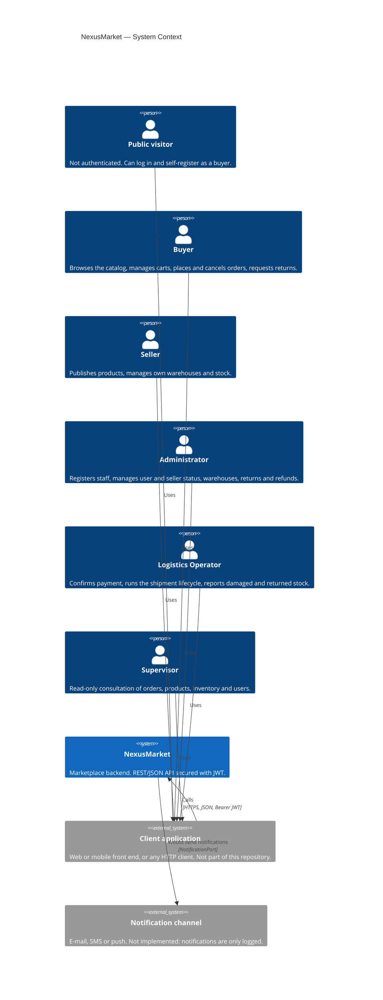

# C4 Level 1 — System Context

## Purpose

Shows NexusMarket as a single system, the people who use it and the systems around it. NexusMarket is a marketplace that mediates between buyers and sellers: it manages catalogs, warehouses and stock, carts, orders, shipments, returns and refunds.

## Diagram

## Notes

* **Actors map to roles.** The five authenticated actors are the `SystemRole` values `BUYER`, `SELLER`, `ADMINISTRATOR`, `LOGISTICS_OPERATOR` and `SUPERVISOR`; each has its own input port (`BuyerPort`, …) and REST controller. The public visitor uses `PublicAccessPort` (login and buyer registration).
* **No real external integrations yet.** There is no payment gateway, carrier or e-mail provider. Payment is confirmed by a logistics operator (`advanceOrderStatus` to `PAID`), and `NotificationPort` is implemented by `LoggingNotificationAdapter`, which only writes to the log; no service calls `NotifyUserService` today.
* **The client is outside the repository.** CORS allows browser clients from the origins in `NEXUS_CORS_ORIGINS` (default `http://localhost:3000` and `http://localhost:5173`).
* MongoDB is part of the system, not an external system; it appears at [level 2](02-level-2-containers.md).
