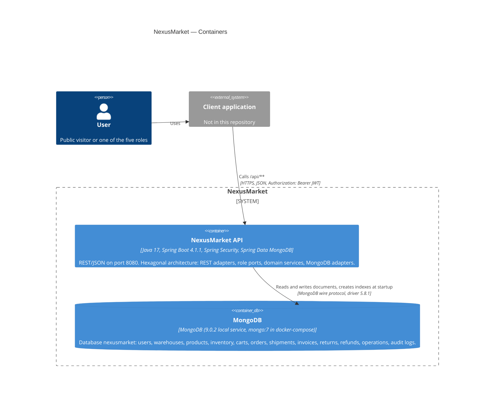

# C4 Level 2 — Containers

## Purpose

Shows the deployable pieces of NexusMarket and how they communicate: the client, the Spring Boot API and the MongoDB database.

## Diagram

## Notes

| Container | Technology | Configuration |
| --------- | ---------- | ------------- |
| NexusMarket API | Java 17, Spring Boot 4.1.1 (`spring-boot-starter-webmvc`, `-security`, `-validation`, `-data-mongodb`), jjwt 0.13.0, Lombok | Port 8080 (Spring default). `NEXUS_JWT_SECRET` (required), `NEXUS_MONGO_URI`, `NEXUS_CORS_ORIGINS`, `NEXUS_ADMIN_EMAIL` / `NEXUS_ADMIN_PASSWORD` |
| MongoDB | MongoDB server; `mongodb-driver-sync` 5.8.1 | URI `spring.mongodb.uri=${NEXUS_MONGO_URI:mongodb://localhost:27017/nexusmarket}` |

* **Stateless API.** No HTTP session: every request carries the JWT. Logout and password change revoke tokens through `users.authTokenVersion` (JWT claim `ver`), stored in the database, so any number of API instances can share the same database.
* **Startup needs MongoDB.** `spring.data.mongodb.auto-index-creation=true` creates the declared indexes at startup, so the API does not start without a reachable server.
* **Single database, thirteen collections**, one per aggregate plus the append-only `operations` and `audit_logs` (see the [persistence layer view](07-layer-adapters-persistence.md)).
* **Containers in this repository.** `Application/Dockerfile` builds the API image (multi-stage) and `Application/docker-compose.yml` runs it with `mongo:7`.
