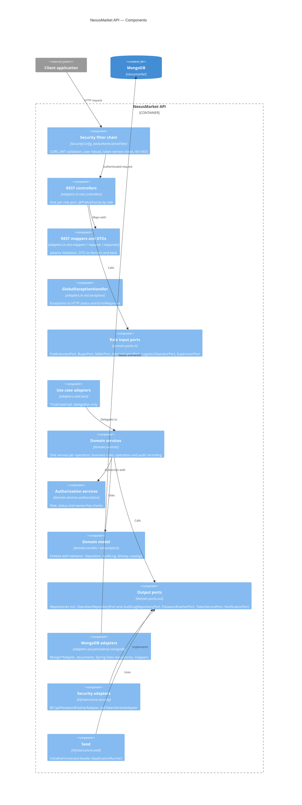
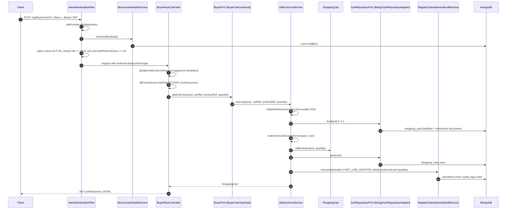

# C4 Level 3 — Components of the API

## Purpose

Shows the main components inside the NexusMarket API container, grouped by hexagonal layer, and follows one request through them from the HTTP filter chain to MongoDB and back.

## Diagram

### Components

`*UseCaseImpl` classes implement the role ports, and the MongoDB adapters implement the output ports; Mermaid C4 draws no separate "implements" arrow, so those two links are described here.

### Lifecycle of a request

`POST /api/buyer/carts/C-1/lines` with a valid buyer token:

## Notes

* **Where a request can stop.** Missing, invalid or revoked token (its `ver` claim differs from the stored `authTokenVersion`) → `401` from the filter chain. Invalid body → `400` from validation. Wrong role → `403` from `@PreAuthorize`. Body validation runs while Spring MVC resolves the controller arguments, before the method (and its `@PreAuthorize` proxy) is invoked, so a user with the wrong role who sends an invalid body gets `400`, not `403`; the port is never called in either case. Unknown code → `400` from a REST mapper. Domain refusal → `403`/`404`/`409` from `GlobalExceptionHandler`. All of them use the same `ErrorResponse` body.
* **Dependency direction.** Every arrow points toward the domain: controllers and use case adapters depend on `domain.ports.in`, services depend on `domain.ports.out`, and the adapters implement those ports. The domain does not import any adapter or infrastructure class.
* **Audit.** The filter does not audit. Every state-changing Domain Service, after saving, calls `RegisterOperationAndAuditService`, which inserts one `Operation` (collection `operations`) and one `AuditLog` (collection `audit_logs`, with the performer's role and the operation details). Successful logins are recorded as `USER_LOGIN`; read-only requests and failed logins are not recorded. Both collections are append-only.
