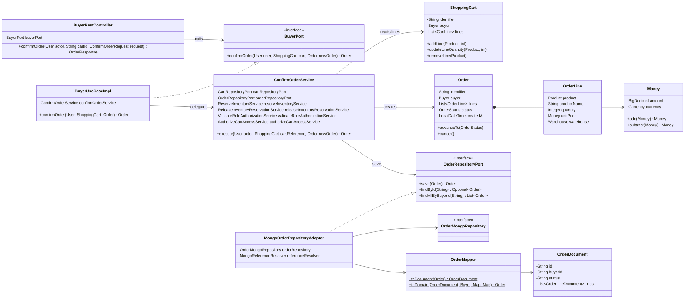
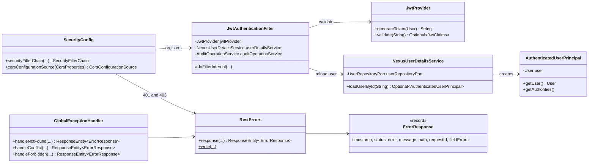

# C4 Level 4 — Code

## Purpose

Shows the key classes behind one representative operation, confirming an order, from the REST controller to the MongoDB document, and the classes that every request shares (security and errors).

## Diagram

### Confirming an order (`POST /api/buyer/carts/{cartId}/orders`)

### Shared by every request

## Notes

* **`ConfirmOrderService.execute`**: checks the role (`BUYER` or `ADMINISTRATOR`), loads the cart, checks cart access, requires the buyer to be `ACTIVE` and `ENABLED` and the cart to be non-empty with `PUBLISHED` products, reserves stock per line with `ReserveInventoryService` (releasing what was already reserved if one line fails), builds the immutable `Order` with its lines, saves it and deletes the cart.
* **Controllers receive the actor** through `@AuthenticationPrincipal(expression = "user") User actor`, i.e. `AuthenticatedUserPrincipal.getUser()` — the user reloaded by `JwtAuthenticationFilter`.
* **`MongoReferenceResolver`** turns the IDs stored in documents (`buyerId`, `productId`, `warehouseId`) back into domain objects, with one query per collection.
* **`ReserveInventoryService`, `AuditOperationService` and the authorization services** are plain classes registered in `infrastructure/config`; the rest of the classes above are component-scanned.
