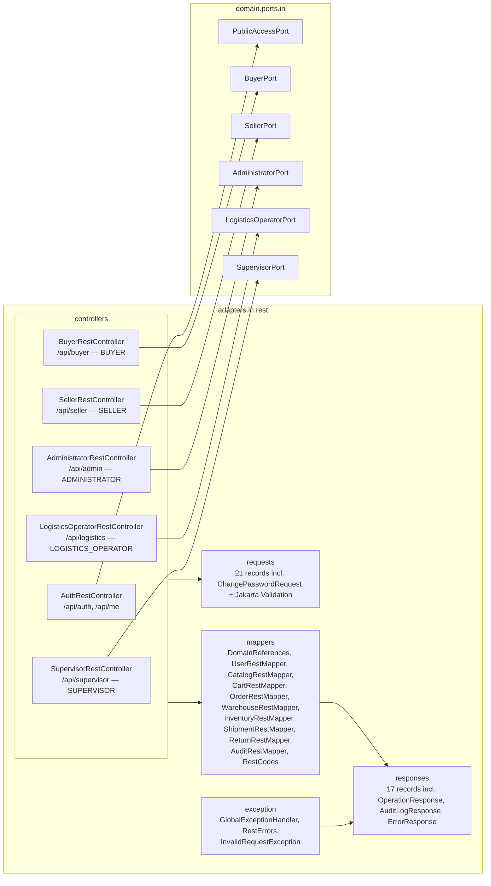

# Layer — REST Adapters

## Purpose

The REST input adapter (`nexussMarket.adapters.in.rest`) turns HTTP requests into calls on the role input ports and domain results into JSON. It holds no business rules.

## Diagram

## Notes

| Controller | Port | `@PreAuthorize` | Endpoints |
| ---------- | ---- | --------------- | --------- |
| `AuthRestController` | `PublicAccessPort` | none (login and register are public; `/api/me` needs any token) | 3 |
| `BuyerRestController` | `BuyerPort` | `hasRole('BUYER')` | 14 |
| `SellerRestController` | `SellerPort` | `hasRole('SELLER')` | 11 |
| `AdministratorRestController` | `AdministratorPort` | `hasRole('ADMINISTRATOR')` | 15 |
| `LogisticsOperatorRestController` | `LogisticsOperatorPort` | `hasRole('LOGISTICS_OPERATOR')` | 11 |
| `SupervisorRestController` | `SupervisorPort` | `hasRole('SUPERVISOR')` | 9 |

* **Each controller injects only its port** (`@RequiredArgsConstructor`, one `private final *Port` field) and gets the actor with `@AuthenticationPrincipal(expression = "user") User actor`.
* **Session endpoints.** Every role controller exposes `POST /logout` and `POST /password` (`ChangePasswordRequest`), both answering `204` with no body; after either one, every earlier token of the caller gets `401`. `SecurityConfig.SESSION_PATHS` (`/api/*/logout`, `/api/*/password`) only requires a valid token; the controller's `@PreAuthorize` still checks the role.
* **Audit consultation.** `AdministratorRestController` and `SupervisorRestController` expose `GET /operations` and `GET /audit-logs` (`OperationResponse[]`, `AuditLogResponse[]`, most recent first, no pagination), mapped by `AuditRestMapper`.
* **Mappers** are `final` classes with static methods. `DomainReferences` builds references from identifiers; `DomainReferences.user(id, role)` builds the `User` subtype from the role sent by the client (abstract `User` targets).
* **Codes** (status, type, role, currency, variant attribute) are resolved in the mappers; an unknown code throws `InvalidRequestException` → `400`.
* **Errors** always use `ErrorResponse` (`timestamp`, `status`, `error`, `message`, `path`, `requestId`, `fieldErrors`). The security chain writes the same body through `RestErrors.write`.
* Details: [Rest-adapters](../Adapters/Rest-adapters.md), [Rest-validation](../Adapters/Rest-validation.md), [Global-exception-handler](../Adapters/Global-exception-handler.md), and the [endpoint flows](11-endpoints-flows.md).
