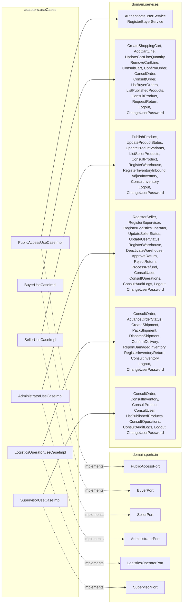

# Layer — Use Case Adapters

## Purpose

`nexussMarket.adapters.useCases` holds one class per role input port. Each class implements its port and only delegates every method to one Domain Service — no rules, validations or branching.

## Diagram

## Notes

| Implementation | Port methods | Delegation (port method → service) |
| -------------- | ------------ | ---------------------------------- |
| `PublicAccessUseCaseImpl` | 2 | `authenticate` → `AuthenticateUserService`, `registerBuyer` → `RegisterBuyerService` |
| `BuyerUseCaseImpl` | 14 | one service per method, named after it (e.g. `confirmOrder` → `ConfirmOrderService`) |
| `SellerUseCaseImpl` | 11 | idem; `registerWarehouse` → `RegisterWarehouseService` |
| `AdministratorUseCaseImpl` | 15 | idem; `registerMarketplaceWarehouse` → `RegisterWarehouseService`, `consultOperations` → `ConsultOperationsService`, `consultAuditLogs` → `ConsultAuditLogsService` |
| `LogisticsOperatorUseCaseImpl` | 11 | idem |
| `SupervisorUseCaseImpl` | 9 | idem; `consultOperations` → `ConsultOperationsService`, `consultAuditLogs` → `ConsultAuditLogsService` |

* All six classes are `@Service` + `@RequiredArgsConstructor` (Lombok) and are found by component scan.
* Shared services: `ConsultProductService`, `ConsultInventoryService`, `ConsultOrderService`, `ConsultUserService`, `ListPublishedProductsService`, `RegisterWarehouseService`, `ConsultOperationsService`, `ConsultAuditLogsService`, `LogoutService` and `ChangeUserPasswordService` are injected into several implementations; each service is still written once.
* Session methods: the five authenticated role ports (not `PublicAccessPort`) declare `logout(User)` → `LogoutService` and `changePassword(User, currentPassword, newPassword)` → `ChangeUserPasswordService`.
* The use case adapters never call `RegisterOperationAndAuditService`: each state-changing Domain Service records its own operation and audit log.
* `RegisterWarehouseService` serves both `SellerPort.registerWarehouse` and `AdministratorPort.registerMarketplaceWarehouse`; it decides the kind of warehouse from the actor's role.
* Details: [Use Case Adapters](../Adapters/Use-cases-adapters.md).
