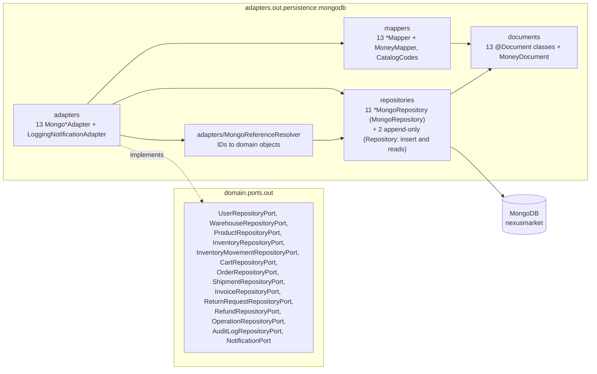

# Layer — Persistence Adapters (MongoDB)

## Purpose

`nexussMarket.adapters.out.persistence.mongodb` implements the persistence output ports on MongoDB with Spring Data. It is the only code that knows how business data is stored.

## Diagram

## Notes

| Port | Adapter | Spring Data repository | Document | Collection |
| ---- | ------- | ---------------------- | -------- | ---------- |
| `UserRepositoryPort` | `MongoUserRepositoryAdapter` | `UserMongoRepository` | `UserDocument` | `users` |
| `WarehouseRepositoryPort` | `MongoWarehouseRepositoryAdapter` | `WarehouseMongoRepository` | `WarehouseDocument` | `warehouses` |
| `ProductRepositoryPort` | `MongoProductRepositoryAdapter` | `ProductMongoRepository` | `ProductDocument` | `products` |
| `InventoryRepositoryPort` | `MongoInventoryRepositoryAdapter` | `InventoryItemMongoRepository` | `InventoryItemDocument` | `inventory_items` |
| `InventoryMovementRepositoryPort` | `MongoInventoryMovementRepositoryAdapter` | `InventoryMovementMongoRepository` | `InventoryMovementDocument` | `inventory_movements` |
| `CartRepositoryPort` | `MongoCartRepositoryAdapter` | `ShoppingCartMongoRepository` | `ShoppingCartDocument` | `shopping_carts` |
| `OrderRepositoryPort` | `MongoOrderRepositoryAdapter` | `OrderMongoRepository` | `OrderDocument` | `orders` |
| `ShipmentRepositoryPort` | `MongoShipmentRepositoryAdapter` | `ShipmentMongoRepository` | `ShipmentDocument` | `shipments` |
| `InvoiceRepositoryPort` | `MongoInvoiceRepositoryAdapter` | `InvoiceMongoRepository` | `InvoiceDocument` | `invoices` |
| `ReturnRequestRepositoryPort` | `MongoReturnRequestRepositoryAdapter` | `ReturnRequestMongoRepository` | `ReturnRequestDocument` | `return_requests` |
| `RefundRepositoryPort` | `MongoRefundRepositoryAdapter` | `RefundMongoRepository` | `RefundDocument` | `refunds` |
| `OperationRepositoryPort` | `MongoOperationRepositoryAdapter` | `OperationMongoRepository` | `OperationDocument` | `operations` |
| `AuditLogRepositoryPort` | `MongoAuditLogRepositoryAdapter` | `AuditLogMongoRepository` | `AuditLogDocument` | `audit_logs` |
| `NotificationPort` | `LoggingNotificationAdapter` | — | — | — (writes to the log) |

* **References by ID.** Documents store related entities as `String` IDs (`buyerId`, `productId`, `warehouseId`, `sellerId`, `ownerId`); `MongoReferenceResolver` (which uses the user, product, warehouse, order and return request repositories) rebuilds full domain objects. Only `MongoUserRepositoryAdapter` does not need it; the operation and audit log adapters use it to rebuild the performer from `performedById`.
* **Append-only audit.** `OperationMongoRepository` and `AuditLogMongoRepository` extend the bare Spring Data `Repository` and declare only `insert` and sorted reads, so `operations` and `audit_logs` can never be updated or deleted through them. Both `findAll` return the most recent first (`executionDate` / `operationDate` descending); legacy `audit_logs` entries without `operationType` are skipped on read.
* **Token version.** `UserDocument.authTokenVersion` stores `User.authTokenVersion` (`users.authTokenVersion`, absent → `0`); `UserMapper` restores it with `restoreAuthTokenVersion`.
* **Embedded data.** Order lines, cart lines, product variants and money (`MoneyDocument`: `Decimal128` amount + currency code) are embedded.
* **Value Objects as codes.** Catalog values are stored by `code` and rebuilt with `fromCode` through `CatalogCodes`; an unknown code fails with `IllegalStateException`.
* **Indexes** are declared with `@Indexed` / `@CompoundIndex` and created at startup (see [Infrastructure](10-layer-infrastructure.md)).
* Details: [Persistence](../Adapters/Persistence.md), [Output Ports](../Domain/Output-ports.md).
