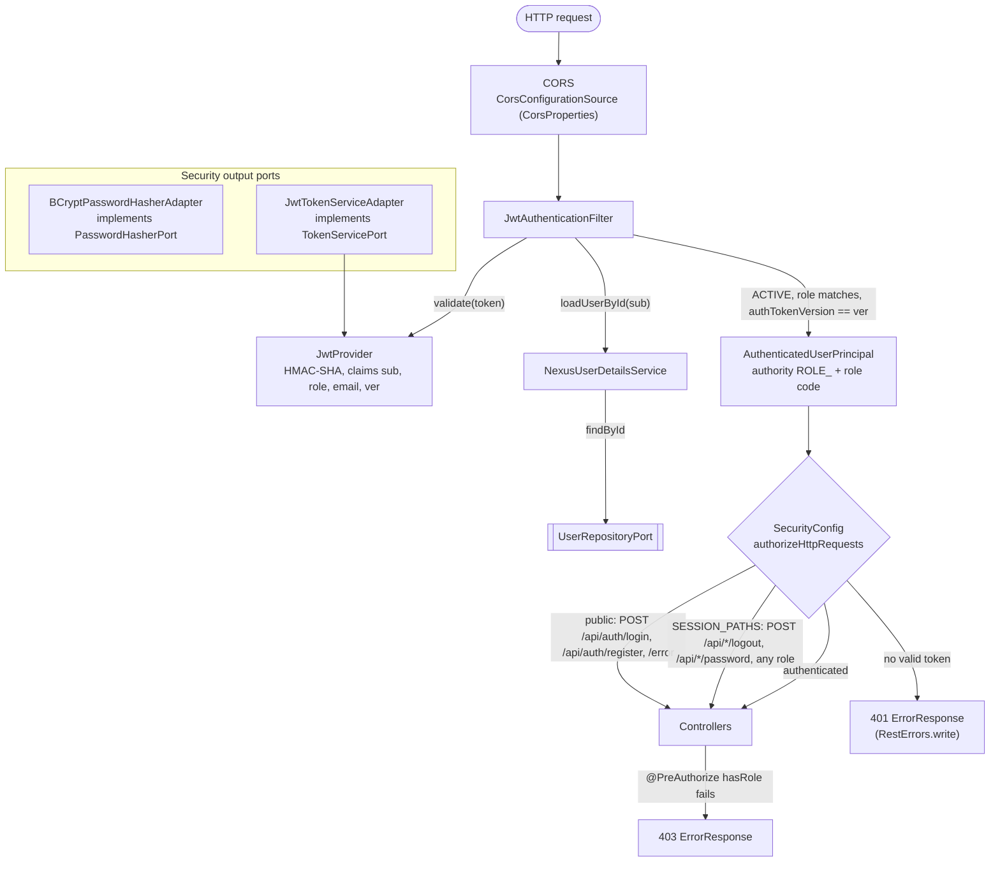

# Layer — Security Adapters

## Purpose

`nexussMarket.infrastructure.security` authenticates requests with JWT, enforces roles together with `@PreAuthorize`, configures CORS, and implements the two security output ports: password hashing and token issuing.

## Diagram

## Notes

| Class | Role |
| ----- | ---- |
| `SecurityConfig` | `@EnableWebSecurity`, `@EnableMethodSecurity`; stateless; CSRF, form login, HTTP Basic and Spring's session logout filter disabled (there is no session to clear, and if mapped to these paths it would answer before the role controllers, skipping the port); public routes; `SESSION_PATHS` (`POST /api/*/logout`, `/api/*/password`) require a valid token of any role, the controller's `@PreAuthorize` checks the role; `401` / `403` written with `RestErrors`; CORS source for `/api/**`. Enables `JwtProperties` and `CorsProperties`. |
| `JwtAuthenticationFilter` | Not a bean on purpose (otherwise it would also run outside the security chain). Validates the token, reloads the user, rejects it if not `ACTIVE`, if its stored role differs from the token, or if the token's `ver` claim differs from the stored `authTokenVersion`. It does not audit: each state-changing Domain Service records its own operation. |
| `JwtProvider` | `generateToken(User)` (claims `sub`, `role`, `email`, `ver` = `authTokenVersion`) and `validate(String)`, which rejects tokens without `sub`, expiration or `ver`. The algorithm follows the key length (HS256 / HS384 / HS512). |
| `JwtProperties` | `nexus.security.jwt.secret` (`NEXUS_JWT_SECRET`, required) and `expiration` (`1h`). |
| `CorsProperties` | `nexus.cors.allowed-origins` (`NEXUS_CORS_ORIGINS`). |
| `NexusUserDetailsService` | Loads users through `UserRepositoryPort`. |
| `AuthenticatedUserPrincipal` | `UserDetails` wrapping the domain `User`; controllers read it with `@AuthenticationPrincipal(expression = "user")`. |
| `BCryptPasswordHasherAdapter` | `PasswordHasherPort` with `BCryptPasswordEncoder`. |
| `JwtTokenServiceAdapter` | `TokenServicePort`, used by `AuthenticateUserService`. |

* **Fresh state over token state.** The token carries enough to rebuild the user, but the filter reloads it so that blocking a user, or changing its role, takes effect at the next request. See [REST Security and CORS](../Adapters/Rest-security-cors.md).
* **Logout and password change revoke tokens.** `LogoutService` and `ChangeUserPasswordService` raise the stored user's `authTokenVersion`; every token issued before, including the one used for the call, then fails the `ver` check and gets `401` at its next request. Logging out twice is harmless.
* **Login.** A wrong email, a wrong password and a user who is not `ACTIVE` all get `401` `"Invalid email or password"` (`AuthenticateUserService`).
* **No secrets in logs.** The filter never logs tokens; `AuditLog` rejects detail keys containing `password`, `hash`, `token` or `secret`, so audit details never carry them.
