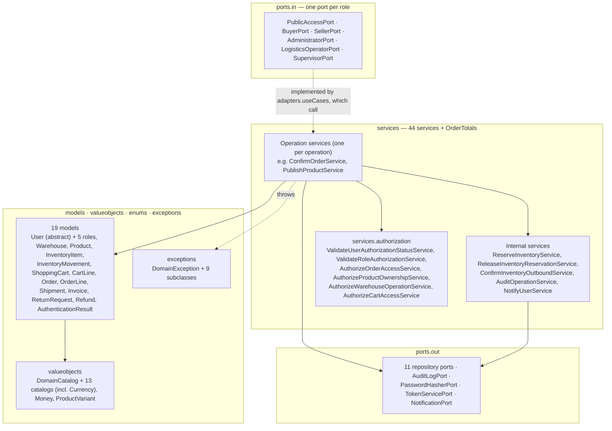

# Layer — Domain

## Purpose

`nexussMarket.domain` holds the business: entities with behavior, value objects, the domain services that implement each operation, the authorization services, and the input and output ports. It depends on no adapter or infrastructure class.

## Diagram

## Notes

* **Entities protect their invariants.** State changes go through behavior methods: `InventoryItem.receive/reserve/releaseReservation/confirmOutbound/adjust/markDamaged`, `Order.advanceTo/cancel`, `ShoppingCart.addLine/updateLineQuantity/removeLine`, `Product.changeStatus/replaceVariants`, `Warehouse.deactivate`, `Shipment.pack/dispatch/confirmDelivery`, `ReturnRequest.approve/reject`, `Refund.process`. `Order`, `OrderLine` and `Invoice` are immutable except for the order status; `User` has no setter for identifier, email or role.
* **Money.** `Money` (amount + `Currency`, never negative, equality ignoring scale) is used for every price and total; a cart accepts a single currency.
* **Services.** Operation services are `@Service` classes with one `execute(...)` method that receives the actor and domain models; authorization and three internal services are plain classes registered in `infrastructure/config`.
* **Exceptions to HTTP.** `EntityNotFoundException` → 404; `OperationNotAllowedException`, `SellerNotAuthorizedException` → 403; `DuplicateResourceException`, `InsufficientStockException`, `InvalidOrderStatusTransitionException`, `InvalidShipmentStatusTransitionException`, `BusinessRuleViolationException` → 409; `InvalidCredentialsException` → 401; other `DomainException` → 400.
* Details: [Domain Model](../Domain/Domain%20Model.md), [Value Objects](../Domain/Domain%20Value%20Objects.md), [Domain Services](../Domain/Domain%20Services.md), [Input Ports](../Domain/Input-ports.md), [Output Ports](../Domain/Output-ports.md).
