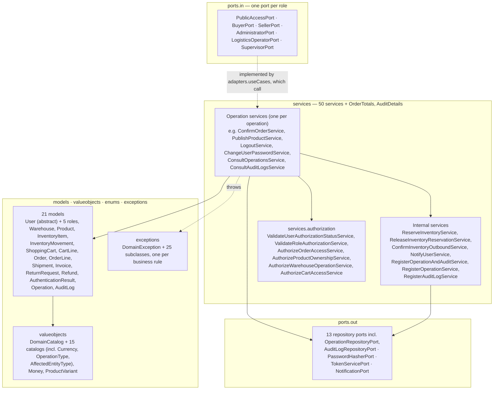

# Layer — Domain

## Purpose

`nexussMarket.domain` holds the business: entities with behavior, value objects, the domain services that implement each operation, the authorization services, and the input and output ports. It depends on no adapter or infrastructure class.

## Diagram

## Notes

* **Entities protect their invariants.** State changes go through behavior methods: `InventoryItem.receive/reserve/releaseReservation/confirmOutbound/adjust/markDamaged`, `Order.advanceTo/cancel`, `ShoppingCart.addLine/updateLineQuantity/removeLine`, `Product.changeStatus/replaceVariants`, `Warehouse.deactivate`, `Shipment.pack/dispatch/confirmDelivery`, `ReturnRequest.approve/reject`, `Refund.process`, `User.bumpAuthTokenVersion`. `Order`, `OrderLine` and `Invoice` are immutable except for the order status; `User` has no setter for identifier, email or role, and its `authTokenVersion` (starts at `0`) only grows through `bumpAuthTokenVersion` (mappers restore it with `restoreAuthTokenVersion`).
* **Auditing.** `Operation` (identifier, `OperationType`, execution date, performer, `AffectedEntityType`, affected entity identifier; immutable, built with `Operation.of`) and `AuditLog` (same data plus the performer's `SystemRole` and a read-only details map that rejects keys naming a password, hash, token or secret). Every state-changing operation service (33 of them, including `AuthenticateUserService` for successful logins, `LogoutService` and `ChangeUserPasswordService`) calls `RegisterOperationAndAuditService.execute(operation, details)` after saving; it saves the `Operation` through `RegisterOperationService` and then an `AuditLog` dated now through `RegisterAuditLogService`. `ConsultOperationsService` and `ConsultAuditLogsService` (`ADMINISTRATOR`, `SUPERVISOR`) read them back.
* **Money.** `Money` (amount + `Currency`, never negative, equality ignoring scale) is used for every price and total; a cart accepts a single currency.
* **Services.** Operation services are `@Service` classes with one `execute(...)` method that receives the actor and domain models; authorization services and the internal `ReserveInventoryService`, `NotifyUserService`, `RegisterOperationService`, `RegisterAuditLogService` and `RegisterOperationAndAuditService` are plain classes registered in `infrastructure/config`.
* **Exceptions to HTTP.** One exception per business rule. `EntityNotFoundException` → 404; `OperationNotAllowedException`, `SellerNotAuthorizedException`, `BuyerNotEnabledException` → 403; `DuplicateResourceException`, `InsufficientStockException`, `InvalidOrderStatusTransitionException`, `InvalidShipmentStatusTransitionException`, `EmptyCartException`, `ProductNotPurchasableException`, `CurrencyMismatchException`, `OrderNotShippableException`, `EmptyOrderException`, `ReturnNotEligibleException`, `ReturnAlreadyDecidedException`, `RefundAlreadyProcessedException`, `InactiveWarehouseException`, `InventoryNotTrackedException` → 409; `InvalidQuantityException`, `InvalidProductPriceException`, `InvalidMoneyException`, `InvalidPasswordException`, `IncorrectCurrentPasswordException`, `OrderStatusRequiresShipmentException` → 400; `InvalidCredentialsException` → 401; any other `DomainException` → 400.
* Details: [Domain Model](../Domain/Domain%20Model.md), [Value Objects](../Domain/Domain%20Value%20Objects.md), [Domain Services](../Domain/Domain%20Services.md), [Input Ports](../Domain/Input-ports.md), [Output Ports](../Domain/Output-ports.md).
