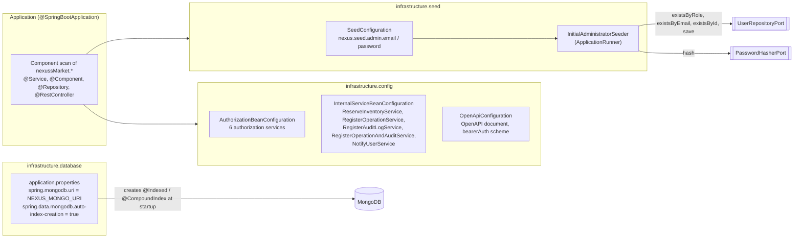

# Layer — Infrastructure

## Purpose

`nexussMarket.infrastructure` holds technical configuration with no business logic: the beans that component scan does not create, the database settings (connection and index creation), the startup seed, and security (described in its own [view](08-layer-adapters-security.md)).

## Diagram

## Notes

### Indexes created at startup

| Collection | Indexes (besides `_id`) |
| ---------- | ----------------------- |
| `users` | `email` (unique) |
| `products` | `status`, `sellerId` |
| `inventory_items` | `product_warehouse` (`productId`, `warehouseId`, unique), `productId` |
| `inventory_movements` | `product_warehouse_occurred` (`productId`, `warehouseId`, `occurredAt`) |
| `shopping_carts` | `buyerId` |
| `orders` | `buyerId` |
| `shipments` | `orderId` (unique) |
| `invoices` | `orderId` (unique), `buyerId` |
| `return_requests` | `orderId` (unique), `buyerId` |
| `refunds` | `returnRequestId` (unique) |
| `operations` | `operationType`, `executionDate`, `performer_execution` (`performedById`, `executionDate` descending), `affected_entity` (`affectedEntityType`, `affectedEntityId`) |
| `audit_logs` | `operationType`, `operationDate`, `performer_operation_date` (`performedById`, `operationDate` descending), `affected_entity` (`affectedEntityType`, `affectedEntityId`) |
| `warehouses` | none |

* **Index creation** is enabled with `spring.data.mongodb.auto-index-creation=true`; in Spring Boot 4.1.1 the property stays under `spring.data.mongodb`, while the connection moved to `spring.mongodb`. The tests set it to `false` because they run without MongoDB. `infrastructure.database` has no class: auto-configuration covers it.
* **Seed.** `InitialAdministratorSeeder` creates the first administrator (identifier `INITIAL-ADMIN`) when `NEXUS_ADMIN_EMAIL` and `NEXUS_ADMIN_PASSWORD` are set and no administrator exists. It is idempotent, checks the variables before touching the database, hashes the password with BCrypt and never logs it. It uses the output ports directly because every registration service needs an administrator actor. Because it bypasses the Domain Services, the seeded administrator is not recorded in `operations` or `audit_logs`.
* **Configuration classes.** Only the authorization services and five internal services (`ReserveInventoryService`, `NotifyUserService` and the three audit services, where `RegisterOperationAndAuditService` receives `RegisterOperationService` and `RegisterAuditLogService`) are plain classes; everything else is component-scanned, so there are no per-use-case configuration classes.
* **Environment.** `NEXUS_JWT_SECRET` (required), `NEXUS_MONGO_URI`, `NEXUS_CORS_ORIGINS`, `NEXUS_ADMIN_EMAIL`, `NEXUS_ADMIN_PASSWORD`.
