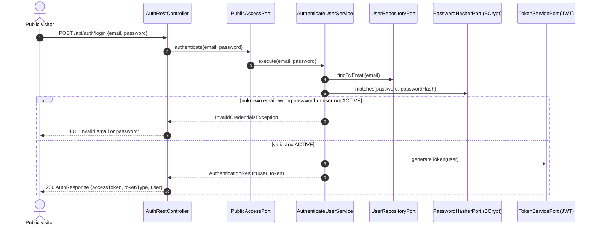
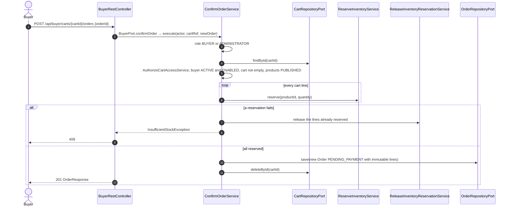
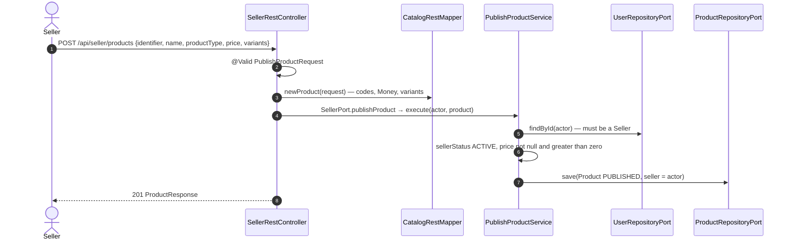
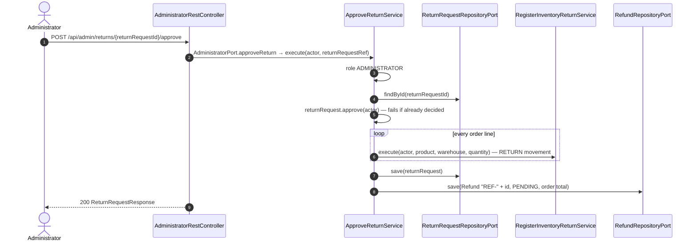
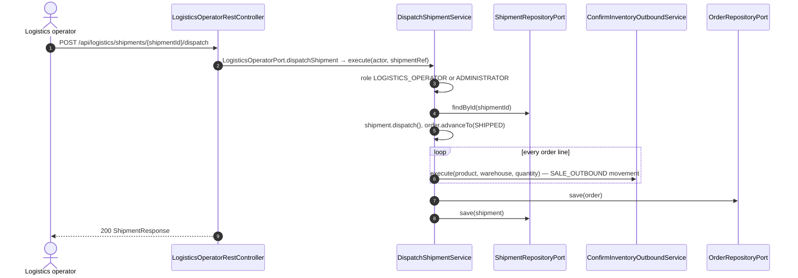
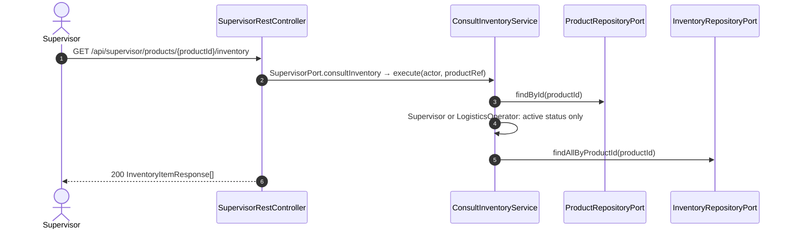
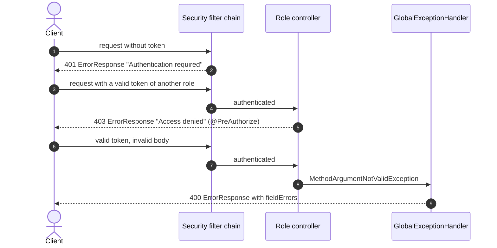

# Endpoint Flows

## Purpose

The complete list of REST endpoints, each traced to the port method and Domain Service it reaches, and one sequence diagram per role showing a representative flow end to end. The matrix was generated from the controllers and the `*UseCaseImpl` classes.

## Diagram

### Endpoint matrix (49 endpoints)

| Method | Path | Role | Port method | Domain service | Request | Response | Success |
| ------ | ---- | ---- | ----------- | -------------- | ------- | -------- | ------- |
| POST | `/api/auth/login` | public | `PublicAccessPort.authenticate` | `AuthenticateUserService` | `LoginRequest` | `AuthResponse` | 200 |
| POST | `/api/auth/register` | public | `PublicAccessPort.registerBuyer` | `RegisterBuyerService` | `RegisterBuyerRequest` | `UserResponse` | 201 |
| GET | `/api/me` | authenticated | — | — (reads the principal) | — | `UserResponse` | 200 |
| POST | `/api/buyer/carts` | BUYER | `BuyerPort.createShoppingCart` | `CreateShoppingCartService` | `CreateCartRequest` | `CartResponse` | 201 |
| GET | `/api/buyer/carts/{cartId}` | BUYER | `BuyerPort.consultCart` | `ConsultCartService` | — | `CartResponse` | 200 |
| POST | `/api/buyer/carts/{cartId}/lines` | BUYER | `BuyerPort.addCartLine` | `AddCartLineService` | `AddCartLineRequest` | `CartResponse` | 200 |
| PUT | `/api/buyer/carts/{cartId}/lines/{productId}` | BUYER | `BuyerPort.updateCartLineQuantity` | `UpdateCartLineQuantityService` | `QuantityRequest` | `CartResponse` | 200 |
| DELETE | `/api/buyer/carts/{cartId}/lines/{productId}` | BUYER | `BuyerPort.removeCartLine` | `RemoveCartLineService` | — | `CartResponse` | 200 |
| POST | `/api/buyer/carts/{cartId}/orders` | BUYER | `BuyerPort.confirmOrder` | `ConfirmOrderService` | `ConfirmOrderRequest` | `OrderResponse` | 201 |
| GET | `/api/buyer/orders` | BUYER | `BuyerPort.listBuyerOrders` | `ListBuyerOrdersService` | — | `OrderResponse[]` | 200 |
| GET | `/api/buyer/orders/{orderId}` | BUYER | `BuyerPort.consultOrder` | `ConsultOrderService` | — | `OrderResponse` | 200 |
| POST | `/api/buyer/orders/{orderId}/cancel` | BUYER | `BuyerPort.cancelOrder` | `CancelOrderService` | — | `OrderResponse` | 200 |
| POST | `/api/buyer/orders/{orderId}/returns` | BUYER | `BuyerPort.requestReturn` | `RequestReturnService` | `RequestReturnRequest` | `ReturnRequestResponse` | 201 |
| GET | `/api/buyer/products` | BUYER | `BuyerPort.listPublishedProducts` | `ListPublishedProductsService` | — | `ProductResponse[]` | 200 |
| GET | `/api/buyer/products/{productId}` | BUYER | `BuyerPort.consultProduct` | `ConsultProductService` | — | `ProductResponse` | 200 |
| POST | `/api/seller/products` | SELLER | `SellerPort.publishProduct` | `PublishProductService` | `PublishProductRequest` | `ProductResponse` | 201 |
| PATCH | `/api/seller/products/{productId}/status` | SELLER | `SellerPort.updateProductStatus` | `UpdateProductStatusService` | `ProductStatusRequest` | `ProductResponse` | 200 |
| PUT | `/api/seller/products/{productId}/variants` | SELLER | `SellerPort.updateProductVariants` | `UpdateProductVariantsService` | `VariantsRequest` | `ProductResponse` | 200 |
| GET | `/api/seller/products` | SELLER | `SellerPort.listSellerProducts` | `ListSellerProductsService` | — | `ProductResponse[]` | 200 |
| GET | `/api/seller/products/{productId}` | SELLER | `SellerPort.consultProduct` | `ConsultProductService` | — | `ProductResponse` | 200 |
| GET | `/api/seller/products/{productId}/inventory` | SELLER | `SellerPort.consultInventory` | `ConsultInventoryService` | — | `InventoryItemResponse[]` | 200 |
| POST | `/api/seller/warehouses` | SELLER | `SellerPort.registerWarehouse` | `RegisterWarehouseService` | `RegisterWarehouseRequest` | `WarehouseResponse` | 201 |
| POST | `/api/seller/inventory/inbound` | SELLER | `SellerPort.registerInventoryInbound` | `RegisterInventoryInboundService` | `InventoryMovementRequest` | `InventoryItemResponse` | 200 |
| POST | `/api/seller/inventory/adjustments` | SELLER | `SellerPort.adjustInventory` | `AdjustInventoryService` | `InventoryAdjustmentRequest` | `InventoryItemResponse` | 200 |
| POST | `/api/admin/sellers` | ADMINISTRATOR | `AdministratorPort.registerSeller` | `RegisterSellerService` | `RegisterStaffRequest` | `UserResponse` | 201 |
| POST | `/api/admin/supervisors` | ADMINISTRATOR | `AdministratorPort.registerSupervisor` | `RegisterSupervisorService` | `RegisterStaffRequest` | `UserResponse` | 201 |
| POST | `/api/admin/logistics-operators` | ADMINISTRATOR | `AdministratorPort.registerLogisticsOperator` | `RegisterLogisticsOperatorService` | `RegisterStaffRequest` | `UserResponse` | 201 |
| PATCH | `/api/admin/sellers/{sellerId}/status` | ADMINISTRATOR | `AdministratorPort.updateSellerStatus` | `UpdateSellerStatusService` | `SellerStatusRequest` | `UserResponse` | 200 |
| PATCH | `/api/admin/users/{userId}/status` | ADMINISTRATOR | `AdministratorPort.updateUserStatus` | `UpdateUserStatusService` | `UserStatusRequest` | `UserResponse` | 200 |
| GET | `/api/admin/users/{userId}?role={role}` | ADMINISTRATOR | `AdministratorPort.consultUser` | `ConsultUserService` | — | `UserResponse` | 200 |
| POST | `/api/admin/warehouses` | ADMINISTRATOR | `AdministratorPort.registerMarketplaceWarehouse` | `RegisterWarehouseService` | `RegisterWarehouseRequest` | `WarehouseResponse` | 201 |
| POST | `/api/admin/warehouses/{warehouseId}/deactivate` | ADMINISTRATOR | `AdministratorPort.deactivateWarehouse` | `DeactivateWarehouseService` | — | `WarehouseResponse` | 200 |
| POST | `/api/admin/returns/{returnRequestId}/approve` | ADMINISTRATOR | `AdministratorPort.approveReturn` | `ApproveReturnService` | — | `ReturnRequestResponse` | 200 |
| POST | `/api/admin/returns/{returnRequestId}/reject` | ADMINISTRATOR | `AdministratorPort.rejectReturn` | `RejectReturnService` | — | `ReturnRequestResponse` | 200 |
| POST | `/api/admin/refunds/{refundId}/process` | ADMINISTRATOR | `AdministratorPort.processRefund` | `ProcessRefundService` | — | `RefundResponse` | 200 |
| GET | `/api/logistics/orders/{orderId}` | LOGISTICS_OPERATOR | `LogisticsOperatorPort.consultOrder` | `ConsultOrderService` | — | `OrderResponse` | 200 |
| POST | `/api/logistics/orders/{orderId}/status` | LOGISTICS_OPERATOR | `LogisticsOperatorPort.advanceOrderStatus` | `AdvanceOrderStatusService` | `AdvanceOrderStatusRequest` | `OrderResponse` | 200 |
| POST | `/api/logistics/shipments` | LOGISTICS_OPERATOR | `LogisticsOperatorPort.createShipment` | `CreateShipmentService` | `CreateShipmentRequest` | `ShipmentResponse` | 201 |
| POST | `/api/logistics/shipments/{shipmentId}/pack` | LOGISTICS_OPERATOR | `LogisticsOperatorPort.packShipment` | `PackShipmentService` | — | `ShipmentResponse` | 200 |
| POST | `/api/logistics/shipments/{shipmentId}/dispatch` | LOGISTICS_OPERATOR | `LogisticsOperatorPort.dispatchShipment` | `DispatchShipmentService` | — | `ShipmentResponse` | 200 |
| POST | `/api/logistics/shipments/{shipmentId}/deliver` | LOGISTICS_OPERATOR | `LogisticsOperatorPort.confirmDelivery` | `ConfirmDeliveryService` | — | `ShipmentResponse` | 200 |
| POST | `/api/logistics/inventory/damaged` | LOGISTICS_OPERATOR | `LogisticsOperatorPort.reportDamagedInventory` | `ReportDamagedInventoryService` | `InventoryMovementRequest` | `InventoryItemResponse` | 200 |
| POST | `/api/logistics/inventory/returns` | LOGISTICS_OPERATOR | `LogisticsOperatorPort.registerInventoryReturn` | `RegisterInventoryReturnService` | `InventoryMovementRequest` | `InventoryItemResponse` | 200 |
| GET | `/api/logistics/products/{productId}/inventory` | LOGISTICS_OPERATOR | `LogisticsOperatorPort.consultInventory` | `ConsultInventoryService` | — | `InventoryItemResponse[]` | 200 |
| GET | `/api/supervisor/orders/{orderId}` | SUPERVISOR | `SupervisorPort.consultOrder` | `ConsultOrderService` | — | `OrderResponse` | 200 |
| GET | `/api/supervisor/products` | SUPERVISOR | `SupervisorPort.listPublishedProducts` | `ListPublishedProductsService` | — | `ProductResponse[]` | 200 |
| GET | `/api/supervisor/products/{productId}` | SUPERVISOR | `SupervisorPort.consultProduct` | `ConsultProductService` | — | `ProductResponse` | 200 |
| GET | `/api/supervisor/products/{productId}/inventory` | SUPERVISOR | `SupervisorPort.consultInventory` | `ConsultInventoryService` | — | `InventoryItemResponse[]` | 200 |
| GET | `/api/supervisor/users/{userId}?role={role}` | SUPERVISOR | `SupervisorPort.consultUser` | `ConsultUserService` | — | `UserResponse` | 200 |

Every endpoint of a role controller is restricted with `@PreAuthorize("hasRole('<ROLE>')")` at class level. All routes need `Authorization: Bearer <token>` except the two public ones.

### Public — login

### Buyer — confirm an order

### Seller — publish a product

### Administrator — approve a return

### Logistics operator — dispatch a shipment

### Supervisor — consult inventory

### Rejected requests

## Notes

* **Status codes.** `201` for creations, `200` otherwise; errors use the uniform `ErrorResponse` (see [Global Exception Handler](../Adapters/Global-exception-handler.md)).
* **Abstract `User` targets.** `/api/admin/users/{userId}` and `/api/supervisor/users/{userId}` need the target's `role` (body of the `PATCH`, `role` query parameter of the `GET`).
* **Shared services.** Several endpoints of different roles reach the same service (e.g. `ConsultOrderService` from the buyer, logistics and supervisor controllers); the service applies the rule for the actor's role.
* Endpoint details and DTO fields: [REST API Endpoints](../Adapters/Api-rest-endpoints.md), [REST Validation](../Adapters/Rest-validation.md).
