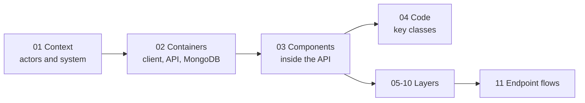

# C4 Model — NexusMarket

## Purpose

Architecture views of NexusMarket following the [C4 model](https://c4model.com): from the system in its environment (level 1) down to key classes (level 4), plus one view per architectural layer and the end-to-end flows of the REST API. Every diagram is written in Mermaid, which GitHub renders directly.

The content was taken from the code (`Application/src/main/java/nexussMarket`): packages, classes, ports, routes and dependencies were checked against the sources, not copied from other documents.

## Diagram

## Documents

| # | Document | Content |
| - | -------- | ------- |
| 01 | [Level 1 — Context](01-level-1-context.md) | Actors (public + 5 roles) and external systems |
| 02 | [Level 2 — Containers](02-level-2-containers.md) | Client, Spring Boot API, MongoDB |
| 03 | [Level 3 — Components](03-level-3-components.md) | Components inside the API and the lifecycle of a request |
| 04 | [Level 4 — Code](04-level-4-code.md) | Key classes and their collaborations |
| 05 | [Layer — REST adapters](05-layer-adapters-rest.md) | Controllers, DTOs, mappers, exception handler |
| 06 | [Layer — Use case adapters](06-layer-adapters-usecases.md) | `*UseCaseImpl` classes implementing the role ports |
| 07 | [Layer — Persistence adapters](07-layer-adapters-persistence.md) | MongoDB adapters, documents, repositories, mappers |
| 08 | [Layer — Security adapters](08-layer-adapters-security.md) | JWT, BCrypt, filter chain, CORS |
| 09 | [Layer — Domain](09-layer-domain.md) | Models, value objects, services, ports |
| 10 | [Layer — Infrastructure](10-layer-infrastructure.md) | Bean configuration, database settings and indexes, seed |
| 11 | [Endpoint flows](11-endpoints-flows.md) | Full endpoint matrix and sequence diagrams per role |

## Layers to Code

| Layer | Package (`nexussMarket.…`) | Main types |
| ----- | -------------------------- | ---------- |
| REST input adapter | `adapters.in.rest` (`controllers`, `requests`, `responses`, `mappers`, `exception`) | `*RestController`, `*Request`, `*Response`, `*RestMapper`, `DomainReferences`, `GlobalExceptionHandler`, `RestErrors` |
| Use case adapters | `adapters.useCases` | `PublicAccessUseCaseImpl`, `BuyerUseCaseImpl`, `SellerUseCaseImpl`, `AdministratorUseCaseImpl`, `LogisticsOperatorUseCaseImpl`, `SupervisorUseCaseImpl` |
| Persistence output adapter | `adapters.out.persistence.mongodb` (`adapters`, `documents`, `repositories`, `mappers`) | `Mongo*Adapter`, `MongoReferenceResolver`, `*Document`, `*MongoRepository`, `*Mapper`, `LoggingNotificationAdapter` |
| Domain | `domain` (`models`, `valueobjects`, `enums`, `exceptions`, `services`, `services.authorization`, `ports.in`, `ports.out`) | Entities, `Money`, catalogs, `*Service`, `*Port` |
| Security | `infrastructure.security` | `SecurityConfig`, `JwtAuthenticationFilter`, `JwtProvider`, `JwtTokenServiceAdapter`, `BCryptPasswordHasherAdapter`, `NexusUserDetailsService`, `AuthenticatedUserPrincipal`, `CorsProperties`, `JwtProperties` |
| Infrastructure | `infrastructure.config`, `infrastructure.database`, `infrastructure.seed` | `AuthorizationBeanConfiguration`, `InternalServiceBeanConfiguration`, `SeedConfiguration`, `InitialAdministratorSeeder` |
| Entry point | `nexussMarket` | `Application` (`@SpringBootApplication`) |

## Notes

* Related documents: [Software Architecture](../Software%20Architecture/Software%20Architecture.md), [Input Ports](../Domain/Input-ports.md), [Output Ports](../Domain/Output-ports.md), [Domain Services](../Domain/Domain%20Services.md), [REST API Endpoints](../Adapters/Api-rest-endpoints.md).
* Mermaid's C4 diagrams (`C4Context`, `C4Container`, `C4Component`) are used for levels 1 to 3; the other views use flowcharts, class diagrams and sequence diagrams.
